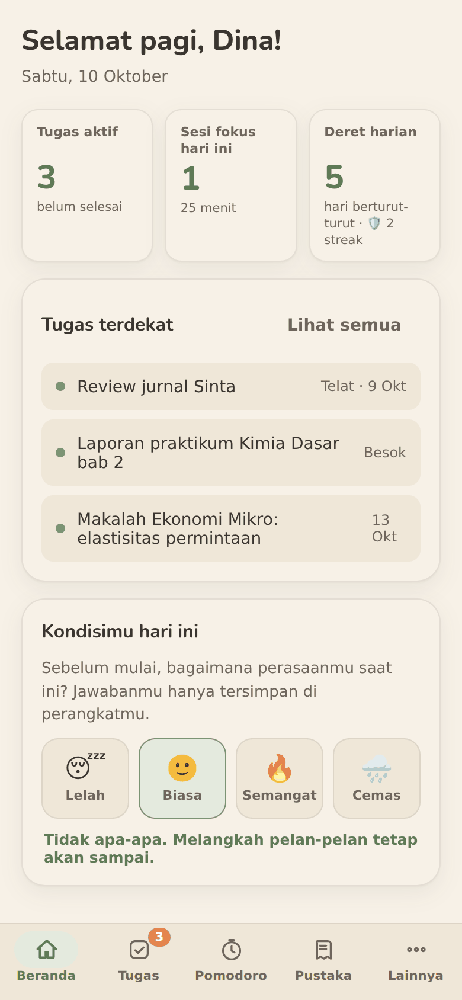
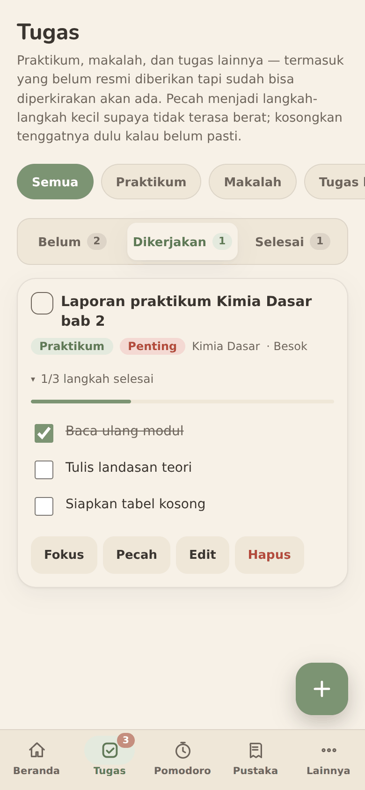
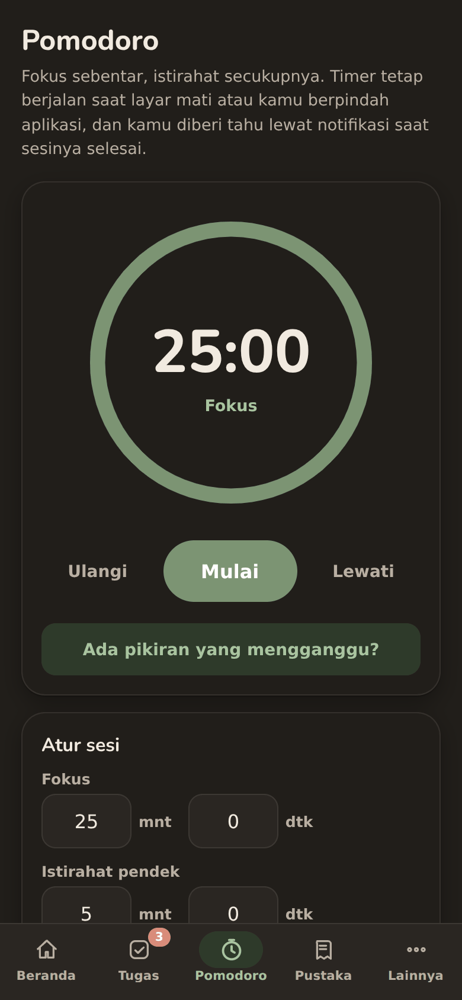
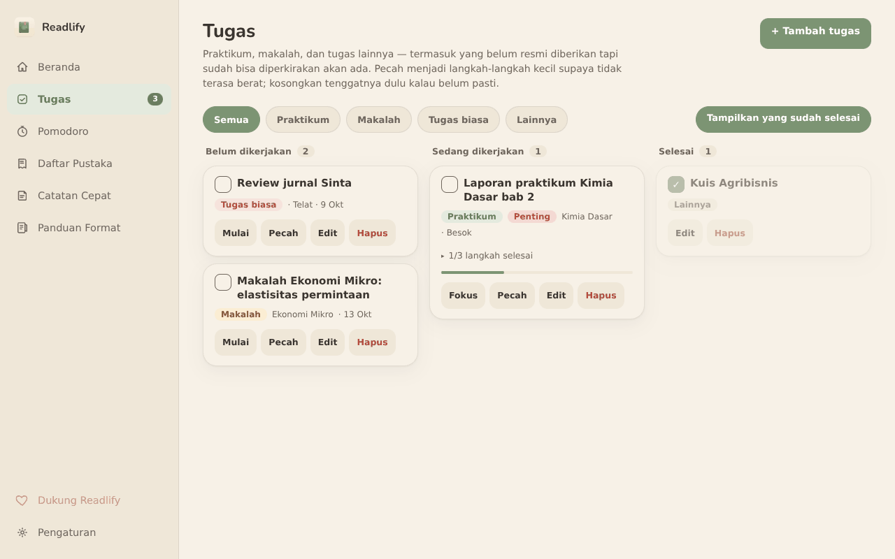

# Readlify untuk Android 📖

> **Readlify** — asisten kuliah anda. Tugas yang dipecah jadi langkah kecil, timer Pomodoro,
> daftar pustaka APA 7th, dan pengingat yang lembut. Dirancang tenang dan ramah ADHD.
>
> *English: a calm, ADHD-friendly study companion for university students — tasks broken into small steps,
> Pomodoro timer, APA 7th reference builder, and gentle reminders. Fully offline: no account, no server,
> no ads, no tracking. Android app (Capacitor), open source (MIT). UI language: Indonesian.*

<p align="center">
  
  
  
</p>
<p align="center">
  
</p>

## Fitur
- **Tugas** praktikum, makalah, dan lainnya, dengan **langkah-langkah kecil** supaya tidak terasa berat;
  tenggat boleh dikosongkan dulu kalau belum pasti.
- **Pomodoro** yang tetap jalan saat layar mati; alarm lewat notifikasi, dengan 5 pilihan suara.
- **Daftar Pustaka** otomatis bergaya Harvard–APA 7th edition, plus **Panduan Format** skripsi.
- **Catatan Cepat** untuk memindahkan pikiran yang mengganggu supaya fokus tetap terjaga.
- **Pengingat lembut**: jam belajar, tenggat (H-3 / H-1 / Hari H), dan dorongan ringan, tidak menghakimi,
  tidak berulang-ulang.
- Tema terang/gelap, **Ekspor/Impor cadangan** (.json), dan bisa memindahkan data dari
  Readlify untuk Windows.
- **Privat sepenuhnya**: tanpa akun, server, iklan, ataupun pelacak. Lihat [PRIVACY.md](PRIVACY.md).

### Tampilan adaptif
| Layar | Tampilan |
|---|---|
| HP | tab bar bawah, tab status tugas, form berbentuk bottom sheet |
| Tablet kecil potret (600–767px) | sidebar ramping (ikon), konten satu kolom |
| Tablet (≥ 768px) | sidebar penuh, papan tugas 2–3 kolom, dialog di tengah, seperti versi desktop |

## Unduh
Ambil `.apk` terbaru di halaman **[Releases](../../releases)**, kirim ke HP, lalu buka (izinkan
"pasang dari sumber ini" jika diminta). Butuh **Android 7.0 (API 24)** atau lebih baru. Berkas `.aab` untuk Google Play
juga disertakan di Releases.

> Status: dicoba di Oppo F11 dan satu tablet Android. Notifikasi dan alarm di latar belakang bergantung
> pada pabrikan (penghemat baterai ColorOS/MIUI/OneUI, dll.). Laporan dari perangkat lain sangat
> membantu, lihat [Issues](../../issues).

## Membuat build sendiri
Tanpa perlu Android Studio: **fork** repositori ini, lalu **Actions → Build APK & AAB Android → Run workflow**.
Unduh hasilnya dari **Artifacts**. Tanpa keystore hasilnya build *debug* (cukup untuk mencoba). Untuk build
bertanda tangan atau Google Play, ikuti [docs/PENANDATANGANAN.md](docs/PENANDATANGANAN.md).

Di komputer sendiri (Node.js 22+, JDK 21, Android SDK):
```bash
npm install
npm run android:add      # buat folder android/ + ikon + suara alarm + sinkron
npm run android:open     # buka di Android Studio
```
Setelah mengubah `www/`: `npm run android:sync`.

## Struktur
```
www/                   aplikasi web yang dibungkus Capacitor (index.html, styles.css, app.js, bridge.js)
resources/native/      ikon notifikasi + 5 suara alarm (.wav), dipasang ke android/ saat build
assets/                sumber ikon & splash (dibuat dari logo)
scripts/               prepare-android.mjs (penyiapan build), generator ikon & suara
.github/workflows/     build APK + AAB otomatis
docs/                  panduan tanda tangan, tangkapan layar
```
Folder `android/` sengaja tidak di-commit: dibuat otomatis oleh `npx cap add android` lalu disiapkan
`scripts/prepare-android.mjs`. Peta kode lengkap ada di [CONTRIBUTING.md](CONTRIBUTING.md).

## Berkontribusi
Isu, usul, dan PR sangat disambut. Baca dulu [CONTRIBUTING.md](CONTRIBUTING.md), terutama bagian
*jati diri aplikasi* (nada hangat, tenang, data tetap lokal). Celah keamanan: lihat [SECURITY.md](SECURITY.md).

## Dukung Readlify
Readlify gratis dan akan tetap gratis; tidak ada fitur yang terkunci. Kalau terasa bermanfaat dan kamu
ingin membantu pengembangannya, ada tautan donasi sukarela di dalam aplikasi (**Dukung Readlify**).
Memberi bintang ⭐, melaporkan bug, atau bercerita ke teman juga sangat berarti.

## Lisensi
[MIT](LICENSE). Font Nunito: SIL Open Font License (`www/fonts/NUNITO-OFL-LICENSE.txt`). Capacitor dan
pluginnya: MIT. Nama dan logo Readlify sebaiknya tidak dipakai untuk versi modifikasi (fork).

Aplikasi ini dibuat dengan bantuan alat AI, lalu ditinjau dan disempurnakan oleh pengembang.
